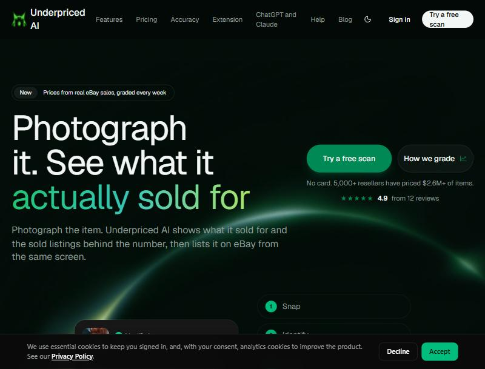
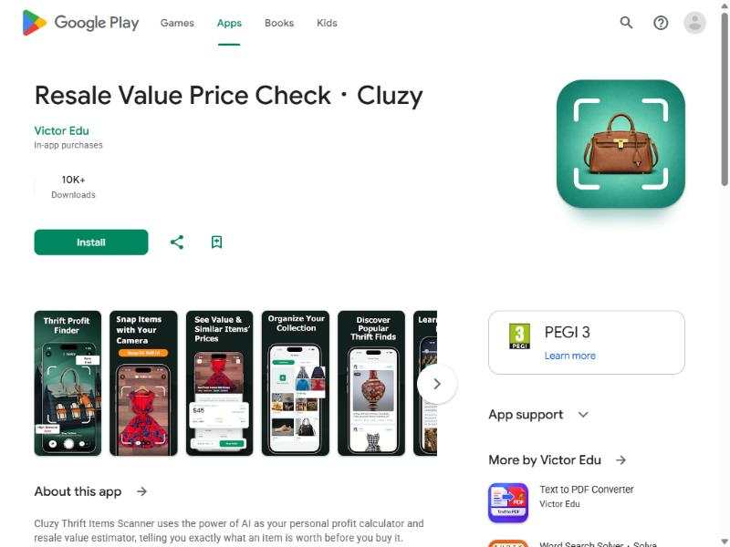
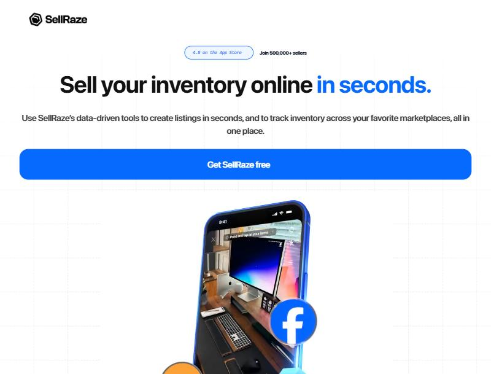

# FlipScan — Competitor Research & What to Add

**Researched:** 2026-10-14 (live, via browser) · **For:** Yan
**Niche:** "snap a photo → what's it worth to resell" apps for thrifters/resellers.

This is a scan of the apps actually winning in FlipScan's exact niche — what they
do right, where they fall down, what real resellers say, and a prioritised list
of what FlipScan should add. Screenshots are in [`screenshots/`](screenshots/).

> **Methodology / honesty note:** these apps were **not hands-on tested**. Findings come
> from their marketing sites, App/Play Store listings + store reviews, and buyer's-guide
> blogs (some by competitors). Treat vendor accuracy claims ("millions of real sales",
> "graded weekly") as *claims*, not verified facts.
>
> **Independent, un-sponsored case studies barely exist for this niche.** It's dominated by
> (a) the apps' own marketing and (b) **affiliate/sponsored YouTube/TikTok** demos — useful
> for seeing the UI run on real items, but the verdicts are paid-for. The only genuinely
> independent signal is **Reddit (r/Flipping, r/reselling) + Facebook reseller groups**, and
> the consensus there is blunt: resellers trust **free eBay sold/image-search + Google Lens**
> as the benchmark and consider the paid AI scanners "nice, not worth a subscription."
> → **Practical implication:** don't pay to test rivals. Benchmark **FlipScan itself** against
> free eBay image-search + Google Lens on real items; that's a truer test than any review.

---

## 1. The landscape at a glance

| App | What it really is | Traction | Price model | Closest to FlipScan? |
|---|---|---|---|---|
| **Underpriced AI** | Photo → real eBay **sold** price + the sold listings behind it, then crosslist | 5,000+ resellers, $2.6M priced, 4.9★ (12) | **Scan packs from $3 / 5 scans, no subscription, credits never expire** | ★★★★★ philosophical twin |
| **ThriftAI** (thriftai.io) | AI scan → "profit potential" | **4.7★, 17,700 reviews** (biggest) | Freemium + sub | ★★★★ |
| **Cluzy** (Resale Value Price Check) | AI scan → value + buy/skip + 1-click eBay list | 10K+ installs, ~4.2–4.5★ | **$6.99/week or $49.99/year** | ★★★★ most feature-overlap |
| **SellRaze** | **Crosslisting** + AI listing + value monitor | 4.8★, **500,000+ sellers** | Free, takes no cut | ★★ (listing-first) |
| **Thrifted: Scan & Price** | Clothing-only scan → value + rarity | 4.2★, 23 ratings (small) | Freemium | ★★★★ (clothing niche) |
| **GrindGuideAI** | Full workflow: scan → max-buy → reviewed eBay draft → inventory | Newer | Sub | ★★★ |
| **WorthPoint / Terapeak / PriceCharting** | Sold-price **databases** (not scanners) | Incumbents | WorthPoint ~$20+/mo; Terapeak free w/ eBay store | — (data layer) |
| **Google Lens + eBay image search** | Free baselines everyone falls back to | Universal | Free | — (the "free brain" combo) |

**Takeaway:** the field splits into three camps —
1. **Scanners** (Cluzy, ThriftAI, Thrifted, Underpriced AI) = FlipScan's camp.
2. **Listers/crosslisters** (SellRaze, Vendoo, List Perfectly) = your girlfriend's app's camp. Resellers distrust "AI slop" listings (see §4), so staying *out* of this is a feature, not a gap.
3. **Pro data tools** (WorthPoint/Terapeak) = the sold-data layer the good scanners quietly sit on top of.

---

## 2. The feature checklist resellers actually judge on

From GrindGuideAI's buyer's-guide (the clearest framing I found). A scanner is
rated on whether it helps you **decide and verify**, not just name the item:

| # | What resellers check | FlipScan today |
|---|---|---|
| 1 | **Item ID** (reads labels, era, brand vs print) | ✅ Strong — 8 guardrails, era, confidence |
| 2 | **Resale value as a RANGE, not a promise** | ✅ Range + low/anchor/high |
| 3 | **Max buy price** ("what can I pay and still profit?") | ⚠️ **Inverted** — asks what you paid, doesn't show max-buy up front |
| 4 | **Confidence + risks** (what's uncertain/damaged) | ✅ Confidence badge + condition + authenticity flags |
| 5 | **Fees + shipping** in the maths | ✅ Net-margin verdict with *your* fee/postage/packaging |
| 6 | **Comps context** (real sold/active listings) | ✅ eBay image-match + SoldComps + shop + web |
| 7 | **Listing workflow** (reviewed draft) | ❌ By design (girlfriend's app) |
| 8 | **Inventory + profit** after the scan | ⚠️ Light log; inventory lives in Alex's app |

**FlipScan already does 1, 2, 4, 5, 6 as well as or better than the paid leaders.**
The one genuine missing table-stake is **#3, Max Buy Price.**

---

## 3. Deep dives

### Underpriced AI — the twin (study this one most)

- **Tagline:** *"Photograph it. See what it actually sold for"* — almost word-for-word FlipScan's "What did it really sell for?". Dark + green aesthetic, near-identical to your redesign. You independently arrived at the same product.
- **What they do right:**
  - **Sold price is the CORE**, not a button — and they show the sold listings behind the number.
  - **Accuracy graded every week, published win or lose** ("against 453 real sales"). Radical-transparency trust play.
  - **No subscription** — scan packs from **$3 for 5 scans, credits never expire.** Deliberately rejected the weekly-sub model resellers hate.
  - **Anti-ChatGPT framing:** *"ChatGPT answers. We help you sell… we show the sold listings behind it."*
  - Works **inside ChatGPT and Claude** (MCP-style).
- **What they do wrong / limits:** crosslist-to-9-marketplaces bloat; one review flags an **ID colour error** ("black… you called it green") and **"a bit pricey."** Even the leader gets colour/ID wrong — FlipScan's label-first guardrails are a real edge.

### Cluzy — most feature-overlap

- **Does almost exactly what FlipScan does**, plus: **buy/skip recommendation**, **1-click eBay listing**, **scan history**, **saved collections**, a social **"discover finds" feed**, and broad categories (antiques, cards, comics, games).
- **Just shipped:** *"Re-Sell Margin Calculator: enter a sale price to see the maximum you should pay"* — i.e. they consider **max-buy** important enough to headline it.
- **What they do wrong:** it's an **app-factory product** (same dev ships Text-to-PDF, Plant ID, a Roast generator — low focus); a recent changelog admits a **nasty bug: "scans show a previous item's result after a retake."** Value claims ("millions of real sales") are **vague** — no transparency on whether it's real comps or an AI guess. **$6.99/week** is steep.
- **Steal:** buy/skip badge, max-buy, scan history. **Skip:** social feed, 1-click listing.

### SellRaze — the listing camp (what NOT to become)

- 500k sellers, 4.8★, but it's a **crosslister** ("list across eBay/Poshmark/Depop/Mercari in seconds"). Scanning is just the on-ramp. Reviews are all about **listing speed**, not pricing accuracy.
- Relevant only as proof that **listing is a separate product** — which is exactly the split you and Alex already made. Don't chase it.

---

## 4. What real resellers say (the honest signal)

Pulled from App Store reviews + Facebook/Reddit reseller groups:

- 🟢 **On scanners generally:** *"identifies item pricing faster than eBay or Google Lens"* (Reddit, on SellRaze's scan). Speed-vs-Lens is the bar to beat.
- 🟢 **On Underpriced AI:** *"Snap a photo and get a real price in seconds is genuinely useful"*; *"helps determine profits — SO HELPFUL"*; support praised repeatedly.
- 🔴 **The skeptic (top-voted answer, Vinted resellers group):** *"eBay solds and I use my brain to write descriptions. Both are free! AI slop in listings is [the problem]."*
  → **This is the most important quote in the whole scan.** Experienced resellers **trust real eBay sold comps** and **distrust AI-written listings**. FlipScan's "real comps + *a guide, not gospel*" honesty, and its refusal to auto-write listings, is **exactly** what converts this crowd.
- 🔴 **Recurring complaints across apps:** weekly subscriptions, ID colour/brand mistakes, vague "AI-estimated" prices with no sources, stale/buggy results.

---

## 5. Where FlipScan already wins

1. **Real reverse-image comps.** Most rivals keyword-search or just AI-guess. FlipScan matches eBay listings by how the item *looks* — genuinely differentiated, and the fix you just saw working.
2. **True net-margin verdict with YOUR costs** (fee/postage/packaging/floor). Rivals show a price; few compute what *you actually keep*.
3. **Honesty as a feature.** "Prices are a guide, not gospel" + transparent sources (eBay / SoldComps / shops / web) beats "millions of sales" hand-waving.
4. **Free, private, personal.** No $6.99/week, no account, no data harvesting, no social feed. For a 2-person tool that's ideal.
5. **Vintage-clothing-tuned** — era detection, brand-vs-print guardrails, condition realism. The generalist apps are weaker here.
6. **Four comp sources in one** (eBay asking + eBay sold + shop prices + web reverse image) — no single competitor spans all four.

---

## 6. What to ADD — prioritised

### 🟢 Build now (cheap, high value, closes a real gap)
1. **Max Buy Price** — the one missing table-stake. You already compute net margin; just invert it: show, *before* the cost box, **"To keep your margin, pay up to €X"** (derived from resale − fees − postage − packaging − your target multiple/floor). Cluzy and GrindGuide both headline this; it's the single most-requested scanner feature and you're ~10 lines from it.
2. **"Accuracy so far" headline** — you already log estimate-vs-actual in the log. Surface it like Underpriced AI's weekly grade: *"On your last N sold items, FlipScan was ~X% off."* Turns your honesty into a visible trust flex, near-zero build.
3. **Recent scans strip** — Cluzy's scan history is a loved feature. A lightweight "last few scans" row (even for un-logged scans, client-side) so you can flick back without re-scanning.

### 🟡 Consider (medium effort, real upside)
4. **Sell-through / demand read** — Cluzy advertises "current market demand + seasonal trends." You can approximate cheaply: eBay **sold count (90d) vs active count** = a "sells fast / slow mover" badge. Tells you not just the price but whether it'll *move*.
5. **Best-platform nudge** — a light rule ("streetwear → Depop; 70s womenswear → Vinted/eBay") so the scan ends with *where* to list, not just the price.
6. **Buy/Skip badge wording** — you already have the 🟢/🟡/🔴 verdict; mirror Cluzy's explicit "Grab it / Skip it" language once max-buy exists so it reads as a decision, not just a number.

### 🔴 Deliberately skip (and why)
- **Crosslisting / auto-written listings** — resellers call it "AI slop," and it's your girlfriend's app's job.
- **Subscriptions** — FlipScan is personal; the free/self-hosted model *is* the edge.
- **Social "discover" feed** (Cluzy) — irrelevant for a private 2-person tool.
- **Broad categories** (antiques/cards/games) — staying clothing-focused is why your ID beats the generalists.

---

## 6b. UI / UX — how FlipScan looks vs the field

**What the leaders do visually:**
- **Underpriced AI:** dark + green (same palette FlipScan landed on), big display type, a
  **visible step flow** (Snap→Identify→Sales→Price→List→Sold), and a **"bought €6 → sold €45"
  proof card**. Looks trustworthy because it *shows its working*.
- **Cluzy:** price as the hero, "similar items" listed under it, **"High Reward" profit badges**;
  plus collections + a social feed (bloat).
- **SellRaze:** light/blue marketing polish, phone mockups, review carousel — but it's a listing tool.

**FlipScan already does right:** dark + lime (best-in-class palette), hero price number,
🟢🟡🔴 decision colour-coding, comp thumbnails, clean single column. Visually ahead of Cluzy.

**UI fixes, prioritised:**
- 🟢 **Fix button overload.** The result stacks 5 equal full-width buttons (shops / web / sold /
  paid / log) → decision fatigue. Make **"What you paid → verdict" the one primary block**; demote
  shops/web/sold into a smaller secondary row or a collapsible **"Dig deeper"** group. One screen, one lead action.
- 🟢 **Add a scan step-flow** (Snap · Identify · Comps · Price) as a thin progress line instead of just
  "Looking…". Cheap, and it builds trust by showing what's happening — the leaders all do it.
- 🟢 **Promote the verdict + max-buy to the top of the result**, above the "dig deeper" buttons, so the
  buy/skip call is the first thing the eye lands on (currently it's below a long scroll).
- 🟡 **Proof card in the log** — mirror Underpriced's "bought €X → sold €Y (kept €Z)" framing on sold items; turns your log into a satisfying scoreboard.
- 🟡 **Tighten the chips** (brand/era/size/condition) into one scannable row; consider an icon per chip.

## 7. One-line positioning

Every rival is either a **vague AI guesser** (Cluzy/ThriftAI) or a **listing factory**
(SellRaze). The only one in FlipScan's lane — **Underpriced AI** — charges per scan and
crosslists. FlipScan's clean lane:

> **"The honest reseller's scanner: real comps matched to how the item actually looks,
> the true profit after your costs, and nothing it can't back up — free and private."**

The single move that most closes the gap with the paid leaders: **add Max Buy Price.**
